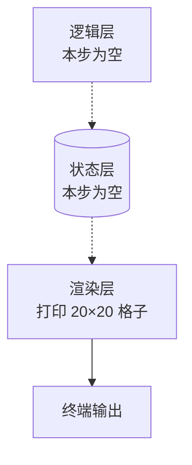

# 第 1 步：画出棋盘

> 里程碑 1 / 共 6 ｜ 主要动的层：渲染 ｜ 预计 25 分钟

## 这一步做完，你会看到什么

终端里出现一个 20×20 的方框棋盘，边框是 `#`，里面是空格，共 20 行。

## 目标

把"舞台"搭起来。这一步**不碰任何游戏规则**，只练一件事：把二维格子按顺序打印到屏幕上。做完你能独立判断"行列谁先谁后、换行放在哪一层循环里"。

## 构建说明

- 新建源码文件 `snake.c`，与第 0 步的 `hello.c` 同目录；
- 构建命令仍是 `gcc snake.c -o snake.exe`（逐词含义见第 0 步），运行 `.\snake.exe`；
- 本步只有一个源文件，没有目录结构变化。

## 本步新面孔（代码出场前先看）

| 名称 | 种类 | 新/旧 | 一句话作用 |
|---|---|---|---|
| `for` | 关键字 | 首次登场 | 按次数重复执行一段代码 |
| `putchar` | 库函数 | 首次登场 | 向终端输出一个字符 |
| `x`、`y` | 循环变量 | 首次登场 | 数学惯例：x 管列（横向）、y 管行（纵向） |
| `printf` | 库函数 | 旧（第 0 步定义） | 打印内容，本步改用更省字符的 `putchar` |

## 状态设计（先想数据，再想画面）

| 数据 | 类型 | 取值范围 | 谁改它 |
|---|---|---|---|
| 当前行号 | int | 0 ≤ y < 20 | 外层循环 |
| 当前列号 | int | 0 ≤ x < 20 | 内层循环 |
| 格子内容 | char | `#` 或空格 | 渲染层判断 |

注意：这一步**还没有状态**——没有蛇、没有食物、没有分数。棋盘是算出来的，不是存出来的。这也是新手最容易乱的地方：**不是所有东西都需要存成变量**。

## 分层结构



虚线表示这一步真的还没有逻辑层和状态层——**先画出来再说**。

## 请你自己写

只给骨架，主体逻辑你自己填：

```c
#include <stdio.h>

int main() {
    // 外层循环：控制行（y）
    for (__________) {
        // 内层循环：控制列（x）
        for (__________) {
            // 判断这个格子该打边框还是空格
            // 提示：x 或 y 等于 0 或 19 时是边框
        }
        // 这一行打完了，该做什么？
    }
    return 0;
}
```

## 先预测

**先不运行**，回答：

1. 我按"外层管行、内层管列"写，屏幕上一行是横着打的，还是竖着打的？
2. 如果把换行 `putchar('\n')` 放进内层循环，会打出一个 20×20 的方框，还是打出 400 行每行一个字符？
3. 棋盘左上角那个格子，`x` 和 `y` 各是多少？

写完你的答案，再往下看。

---

### 判定要点（作答后再看）

- 第 1 题答"横着"：对。一行由内层循环一个字符一个字符凑出来。
- 第 2 题答"方框"：**错**。换行放在内层，每打一个字符就换行，结果是 400 行、每行一个字符，竖成一根线。归入"结构"错误——换行属于"行"的边界，必须待在外层循环末尾。
- 第 3 题答 `(0,0)`：对。行号自 0 起、列号自 0 起，是编程的常规起点；但屏幕第一行第一列在**上**不在下，第 2 步移动时会用到这条。

## 双轨走查

| 节拍 | 状态变化 | 代码/流程动作 | 屏幕或输出 | 用户任务 |
|---|---|---|---|---|
| 1 | 无 | 只有一个空的 `main` | 什么都不打 | 说出"没输出"是因为没写打印 |
| 2 | 无 | 内层循环打印一个字符，不换行 | 一行连续 20 个字符 | 预测下一行会接在哪 |
| 3 | 无 | 外层循环末尾加 `\n` | 20 行、每行 20 字符 | 判断这块是不是矩形 |
| 4 | 无 | 加入边框判断 | 四周一圈 `#`，内部空格 | 说出哪个条件让 `(0,0)` 变成 `#` |
| 5 | 无 | 把 20 改成 40 | 棋盘放大一倍 | 预测 `x==19` 的判断还灵不灵 |

## 运行与观察

- 启动命令：`gcc snake.c -o snake.exe; .\snake.exe`
- 预期输出：20 行，每行 20 个字符，四边为 `#`
- 若不一样，先看这三处：
  1. 换行是不是被放进了内层（表现为竖成一根线）；
  2. 边框条件是不是把 `x == 19` 写成了 `x <= 19`（表现为多一列）；
  3. 行列是不是写反了（表现为长宽颠倒）。

## 定位修正

| 现象 | 层 | 最小提示 |
|---|---|---|
| 全是一行长条 | 结构（循环嵌套） | "换行那句话，你放在内层还是外层？" |
| 矩形变成竖线 | 结构 | "每打一个字符就换行，一行还能有 20 个吗？" |
| 边框缺一段 | 逻辑（条件） | "四个边你有几种情况？`x` 管左右、`y` 管上下，都覆盖了吗？" |
| 出现乱码方块 | 环境（编码） | "棋盘只用 ASCII 吗？先把边框换成 `#` 试试。" |

## 变式迁移

把棋盘从 20×20 改成 40×40，**只改一个地方**。预测：哪些数字要跟着改？边框判断里有没有写死的 `19`？

答对要点：尺寸最好收成一个变量或常量，改一处、全盘生效；写死的 `19` 就是下一局布置的隐患。这也是后面"参数"错误的源头。

## 常见错误

- 换行放进内层循环 → 竖成一根线；
- 边框条件用 `<=` 而非 `==` → 多画一圈；
- 行列写反 → 长方形变竖条；
- 用中文全角字符画边框 → 占两个字符宽度，棋盘错位；
- 把 `19` 到处写死 → 第 5 步改尺寸时全线崩溃。

## 出口验收

- 迁移题：上面"改成 40×40"那道，要求说清"改哪一处、为什么只改这一处就够"。
- 旧步复习题（来自第 0 步）：编译成功但终端没有额外输出，这是成功还是失败？为什么？
- 验收标准：棋盘能打出来 + 你能用自己的话说清"为什么换行必须在外层"。

## 完成补记（用户验收通过后填）

- 实际跑通的代码要点：
- 踩过的坑：
- 待复习：
