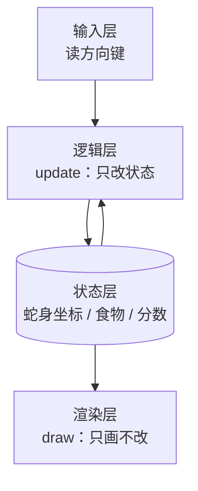

# 贪吃蛇·项目笔记

## 项目目标

用 C 语言在终端做一个能玩的贪吃蛇：20×20 棋盘、方向键控制、吃食物变长、撞墙或撞自己结束、带计分。

## 运行方式

- 语言与版本：C（gcc 13.2）
- 启动命令：`gcc snake.c -o snake && ./snake`（Windows 下为 `gcc snake.c -o snake.exe` 后运行 `snake.exe`）
- 结果在哪看：终端窗口，看不到中文乱码即为编码正常

## 里程碑进度表

| 步 | 主题 | 主要层 | 可见结果 | 状态 |
|---|---|---|---|---|
| 0 | 环境自检 | 环境 | 终端打印一行字 | ✅ |
| 1 | 画出棋盘 | 渲染 | 一片 20×20 空棋盘 | 🟡 |
| 2 | 一个点能动 | 输入 + 状态 | 点随方向键移动 | ⬜ |
| 3 | 一条蛇会变长 | 逻辑（状态更新） | 吃到食物变长、食物换位 | ⬜ |
| 4 | 撞墙即结束 | 逻辑（边界） | 撞上后停下并提示 | ⬜ |
| 5 | 计分与重开 | 逻辑 + 渲染 | 一局完整可玩 | ⬜ |

## 分层结构

## 学习看板

- 项目推进：1 / 6 里程碑
- 验收掌握度：1.5 / 6（✅=1，🟡=0.5，🔴/⏭ =0）
- 待复习：1 项（"行列谁先谁后"）
- 当前里程碑：第 1 步 · 画出棋盘
- 下一步建议：先把"行内循环、行间换行"说清，再做第 1 步变式
- 下一里程碑：第 1 步达到 ✅

## 里程碑索引

- [第 0 步·环境自检](steps/第00步-环境自检.md)
- [第 1 步·画出棋盘](steps/第01步-画出棋盘.md)
- [第 2 步·大纲与卡片草稿](N+2-第02步-大纲与卡片草稿.md)
