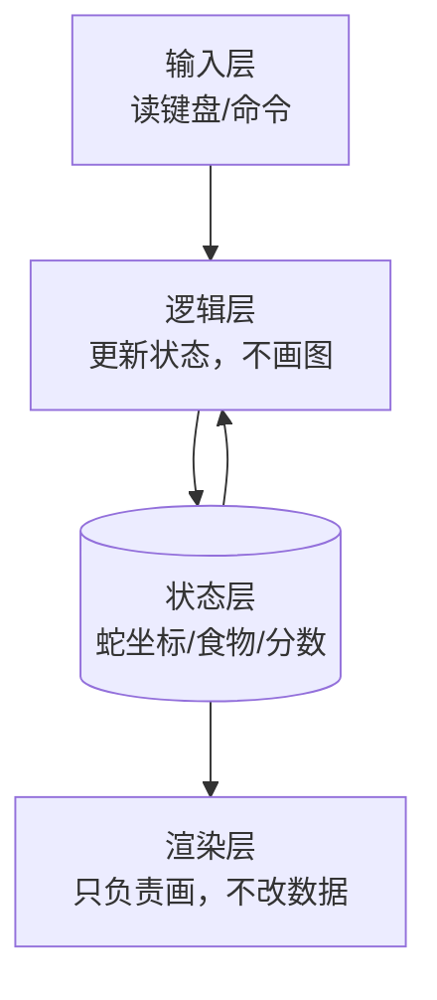

# 里程碑拆分

把一个大项目拆成**每个都能独立运行、有可见结果**的小步。每步只增加一个可观察的新行为。本文件是项目详例的唯一所在地，其他文件只引用、不重复。

## 零、第 0 步：环境自检（先能跑，再谈学）

**这一步不算里程碑，却决定后面能不能走。** 新手第一次做项目，卡死的地方八成不在逻辑，而在"命令打不开、模块找不到、写进去一片乱码"。

### 六件事

1. **定运行方式**：终端程序、网页、还是窗口程序；在哪个目录、用哪条命令启动。
2. **确认工具链**：版本查得到的就查，缺什么补什么。
3. **跑通最小输出**：能看见一行字 / 一个空窗口 / 一个空白页面。
4. **搭项目骨架、讲清构建**：建好目录与源码文件，讲清从源码到能跑的程序经过哪些命令（编译 / 解释 / 构建），逐词解释，不丢一条光命令让学员照敲；多文件项目讲清文件之间怎么找到彼此。
5. **备份就位（条件项）**：Git 模块开启时——`git init`、写 `.gitignore`（挡住 exe/o/pyc 等生成物）、首次提交"第0步 环境自检通过"；Git 模块关闭时——改用文件夹快照（同级建 `备份-第0步-<日期>/` 复制一份源码）。详见 [Git 备份追回与调试](git-and-debug.md)。
6. **说清"谁运行、怎么看"**：用户自己敲命令，还是 AI 代跑；输出去终端、浏览器还是文件；报错怎么贴回来。

### 按运行方式的对照

| 类型 | 先查什么 | 最小跑通 | 结果在哪看 |
|---|---|---|---|
| 终端 · Python | `python --version` | `print("hi")` | 终端回显 |
| 终端 · C/C++ | `gcc --version` 或 `clang --version` | 编译后运行 `hello` | 终端回显 |
| 终端 · Node | `node -v` | `console.log("hi")` | 终端回显 |
| 网页 | 能否双击打开 html | 一个空白 `index.html` | 浏览器页面 |
| 窗口 · Python | `python -c "import tkinter"` | 一个空窗口 | 弹出的窗口 |

### 边界

- 环境配置、脚手架生成、读报错**可由 AI 代劳**——不是学习目标，不拿它考用户；但**构建命令的含义要让用户理解并自己敲**；Git 开启时提交动作也要用户自己敲，Git 关闭时复制快照的动作同样让用户自己动手。
- 装好后把**语言版本、构建与运行命令、备份方式（Git 仓库位置或快照目录）、踩过的坑（编码、路径、权限）**写进 `project-state.md`。
- 验收标准：用户能自己重跑一次，看到同样的输出，并说清启动命令每个词的作用。做不到就不许进第 1 步。
- Windows 上常见的两个坑：中文路径导致编译失败、控制台默认编码导致中文乱码（`PYTHONUTF8=1` 可解）。

## 一、通用拆分模板

| 步 | 做什么 | 主要动的层 | 可见结果 |
|---|---|---|---|
| 0 | 环境自检，跑通最小输出 | 环境 | 一行字 / 空窗口 |
| 1 | 把"舞台 / 界面"搭起来 | 渲染层 | 打印出一个空场景 |
| 2 | 一个能动的东西 | 输入层 + 状态层 | 一个点随输入移动 |
| 3 | 一个会变的规则 | 逻辑层 | 数量 / 计分 / 增删随操作变化 |
| 4 | 边界与失败 | 逻辑层（边界） | 越界 / 结束 / 报错能被正确处理 |
| 5 | 打磨 | 逻辑层 + 渲染层 | 计分、提速、重新开始 |

原则：**每步结束程序都能跑、都能看见结果**；若某步跑不通，退回上一步确认，不硬着头皮往下写。

## 二、完整示例：贪吃蛇（C 语言终端版）

这是本技能的参考详例。五步，每步都标出新增的是哪一层。

### 第 1 步：画出棋盘

- 目标：清屏后打印 20×20 的格子。
- 动的层：渲染层（只打印，无状态、无逻辑）。
- 可见结果：一片空棋盘。
- 先预测：`(0,0)` 在左上角还是左下角？行与列哪个先循环？
- 常见错误：行列颠倒、边界多打一格、清屏命令写成了换行。

### 第 2 步：一个点，能随方向移动

- 目标：棋盘上有一个点，按方向键后位置改变。
- 动的层：输入层（读键）+ 状态层（点的坐标）。
- 可见结果：点随按键在格内移动。
- 先预测：按一次右，点的坐标从 `(x,y)` 变成什么？
- 常见错误：方向判断写死、坐标改了但没重绘（看起来没动）。

### 第 3 步：一条蛇，吃食物变长

- 目标：蛇由多点组成，吃到食物后变长，食物换个位置重新生成。
- 动的层：状态层（蛇的数组 + 食物坐标）。
- 可见结果：蛇变长、分数上升、食物跳位。
- 先预测：吃到食物那一刻，`score` 和食物坐标各怎么变？蛇尾哪一节被保留？
- 常见错误：只更新头忘了尾、变长时没复制最后一节、食物随机到蛇身上。

### 第 4 步：撞墙与撞自己就结束

- 目标：撞到边界或撞到自身，游戏停止。
- 动的层：逻辑层（边界判断）。
- 可见结果：撞上后程序停下并提示。
- 先预测：坐标恰好等于边界值时，算撞墙还是算通过？
- 常见错误：`>` 与 `>=` 混淆、漏判撞自己、结束后还在循环。

### 第 5 步：计分、提速、重新开始

- 目标：分数累计、速度随分数变快、结束后能重开一局。
- 动的层：逻辑层（节奏与重置）+ 渲染层（分数显示）。
- 可见结果：一局完整的游戏，能玩、能重开。

### 三层结构（贯穿五步）

先想"状态怎么变"，再想"怎么显示"。规则与显示混写，后期加功能会越来越难。

## 三、其他项目的最小拆分

| 项目 | 五步 |
|---|---|
| 待办清单（任意语言 + 命令行） | 空清单可退出 → `add 买牛奶` 能加 → `done 1` 能标完成 → `rm 1` 能删（边界：空清单、越界编号）→ 持久化到文件 + 启动读取 |
| 计算器（命令行） | 读两数打印和 → 支持 `+ - * /` → 处理除零与非法输入 → 连续计算 / 括号 / 变量（可选） |
| 网页小游戏 | 空白页面 → 键盘控制一个方块 → 加碰撞规则 → 计分与结束条件 → 优化手感与样式 |

## 四、规模降级规则

- **判定过大**：用户要的东西用 3-6 个可运行里程碑覆盖不了（如"做个聊天软件""做个 App""做个网站商城"）。
- **降级做法**：砍到最小可玩版（MVP），把剩余功能列进"以后再加"清单，**明确告诉用户砍了什么、为什么砍**。
- **优先级**：能玩通的核心闭环 > 好看 > 更多功能。
- **记录**：降级决定写进 `project-state.md`，下次续学不重复讨论。

## 五、拆分原则

- 每步结束**程序都能跑**，能看到结果；
- 每步只加**一个**新行为，方便定位错误；
- 若某步跑不通，退回上一步确认，不硬着头皮往下写；
- 最后一步才是"完整产品"，前面每一步都是完整可运行的"半成品"。
