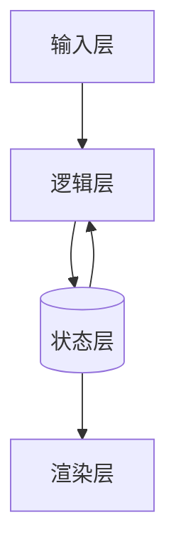
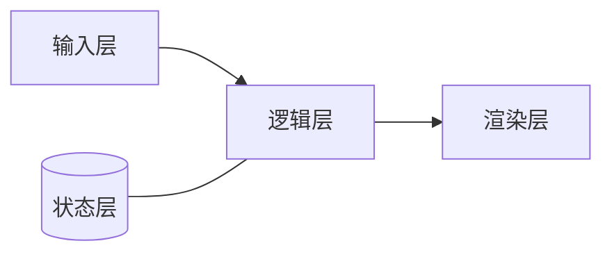

# 教学文档与产物

本技能必须留下**可留存的 Markdown 文档**，不能只把内容说在对话里。用户用 Typora 阅读，所以流程图、分层图、状态转移一律用 **Mermaid 代码块**（Typora 原生渲染），不画 ASCII 图。

## 一、五件产物

| 产物 | 文件名 | 用途 | 何时生成 |
|---|---|---|---|
| 项目笔记 | `项目笔记.md` | 项目目标、构建方式、分层结构图、里程碑进度表、学习看板、运行方式 | 第 0 步通过后建档，每次推进刷新 |
| 单步教学页 | `第N步-<主题>.md` | 单个里程碑的导师蓝本，可照着做 | 进入该里程碑前 |
| 卡片源文档 | `卡片-源文档.md` | 全部记忆卡片的代码 / 命令原文（含正式注释） | 每次推进追加 |
| 卡片打字文档 | `卡片-打字文档.md` | 空白默写版，与源文档编号一一对应 | 与源文档同步追加 |
| 项目状态 | `project-state.md` | 跨会话续学：当前里程碑、已完成、构建与运行方式、能力选项（Git / 注释开关）、备份记录、验收记录、复习队列、薄弱点 | 建档时创建，每次推进更新 |

### 目录约定

```
<项目目录>/
├── 项目笔记.md
├── project-state.md
├── 卡片-源文档.md
├── 卡片-打字文档.md
├── steps/
│   ├── 第00步-环境自检.md
│   ├── 第01步-画出棋盘.md
│   └── 第02步-一个点能动.md
└── N+2-第03步-大纲与卡片草稿.md
```

- 目录与命名**沿用用户既有习惯**；用户没给目录就先问，不从记忆硬猜。
- 已有同名文档时先读后改，只更新需要变的字段，不为套模板重写整篇。

## 二、单步教学页模板

**关键约束：文档是导师蓝本，不是标准答案。** 可以给接口骨架、伪代码、数据设计，**不给主体实现代码**——主体逻辑由用户自己写。但代码里每个构件都要按 [代码讲解与注释规范](code-explanation.md) 讲透，**默认学员什么都没见过**。

````markdown
# 第 N 步：<主题>

> 里程碑 N / 共 M ｜ 主要动的层：<输入 | 状态 | 逻辑 | 渲染> ｜ 预计 <X> 分钟

## 这一步做完，你会看到什么
<一句话描述可见结果>

## 目标
<学完能独立判断什么、能独立做到什么>

## 构建说明
<本步动了哪些文件、目录结构有无变化；从源码到能跑的完整命令，逐词说清作用；
多文件项目讲清文件之间怎么找到彼此。只在构建方式变化时详写，未变化写"沿用第 N-1 步"。>

## 本步新面孔（代码出场前先看）

| 名称 | 种类 | 新/旧 | 一句话作用 |
|---|---|---|---|
| | 函数/变量/关键字 | 首次登场 / 旧（第k步定义） | |

<旧构件必须写清第几步定义、当时干什么、本步拿它做什么，不许只写"前面讲过"。>

## 状态设计（先想数据，再想画面）

| 数据 | 类型 | 取值范围 | 谁改它 |
|---|---|---|---|
| 例：蛇头坐标 | (int, int) | 0 ≤ x,y < 20 | 逻辑层 |

## 分层结构



## 先预测

<一个可判断的问题，一次只问一个变量>

1. ……
2. ……

写完你的答案，再往下看。

---

### 判定要点（作答后再看）

- 若答 A：说明……
- 若答 B：说明……，归入<哪一类错误>
- 若答 C：……

## 双轨走查

| 节拍 | 状态变化 | 代码/流程动作 | 屏幕或输出 | 用户任务 |
|---|---|---|---|---|
| 1 | | | | 预测…… |
| 2 | | | | 说出属于哪一层 |
| 3 | | | | 判断是否和预测一致 |

- 每行只描述**一个可观察状态**，节拍 3-7 个。
- 走查表里的"代码/流程动作"写**做什么**，不写完整实现。

## 运行与观察

- 启动命令：<写具体命令，含目录>
- 预期输出：<跑对了应该看到什么>
- 若不一样，先看这三处：<本步最可能出问题的两三层>

## 定位修正

本步常见的两层问题：

| 现象 | 层 | 最小提示 |
|---|---|---|
| | | <一个引导问题，不给答案> |

## 变式迁移

改变 <一个条件>，预测 <结果>；指出哪一层的哪一处要改。

## 常见错误

- ……

## 出口验收

- 迁移题：……
- 旧步复习题（第 2 步起必填）：……
- 验收标准：程序能手动跑通 + 能用自己的话解释状态怎么变。

## 完成补记（用户验收通过后填）

- 实际跑通的代码要点：<从用户自己的代码里摘，保留符合三档规则的正式注释>
- 踩过的坑：<含调试过程：病因 + 药方>
- 待复习：
- 备份记录：<Git 开启 → 提交哈希前 7 位 + 提交信息"第N步 主题 验收通过"；Git 关闭 → 快照目录名"备份-第N步-<日期>">
- 注释：<注释模块开启 → 学员自己写的注释稿要点与点评结论；关闭 → 记"注释由导师写，学员只求读懂">
````

## 三、项目笔记模板

````markdown
# <项目名>·项目笔记

## 项目目标
<一句话：做成什么、给谁用、能干什么>

## 运行方式
- 语言与版本：
- 启动命令：
- 结果在哪看：

## 里程碑进度表

| 步 | 主题 | 主要层 | 可见结果 | 状态 |
|---|---|---|---|---|
| 0 | 环境自检 | 环境 | 一行字 / 空窗口 | ✅ |
| 1 | 画出棋盘 | 渲染 | 空棋盘 | 🟡 |
| 2 | 一个点能动 | 输入 + 状态 | 点随键移动 | ⬜ |

## 分层结构



## 学习看板

- 项目推进：2 / 6 里程碑
- 验收掌握度：1.5 / 6（✅=1，🟡=0.5，🔴/⏭ =0）
- 待复习：2 项
- 当前里程碑：第 2 步 · 一个点能动
- 下一步建议：先补"坐标改了要重绘"，再做第 2 步变式
- 下一里程碑：第 2 步达到 ✅

## 里程碑索引

- [第 0 步·环境自检](steps/第00步-环境自检.md)
- [第 1 步·画出棋盘](steps/第01步-画出棋盘.md)
````

### 看板规则

- 数字必须能由进度表、验收记录和复习队列**算出来**；信息不足时写"总数待确认"，不写估计值。
- 推进 = 已验收或已跳过的里程碑数 / 总里程碑数。
- "下一步建议"要具体到薄弱点或到期复习项，不写"继续加油"。
- `project-state.md` 里同步存同一份看板摘要，便于跨会话恢复。

## 四、卡片两件套

| 文件 | 内容 |
|---|---|
| `卡片-源文档.md` | 卡片编号、标题、代码 / 命令原文、一句要点 |
| `卡片-打字文档.md` | 同样的编号与标题，**只有空代码块** |

规则：

- **编号、顺序、代码块语言标记**必须两份一致。
- 卡片按**知识点出现先后**排列——先学的在前，不按重要性重排。
- 原文取**用户通过验收时实际跑通的那段代码**，不是导师预先写的标准答案。
- 打字文档是**空白默写版**：不放代码片段、不放占位符、不放提示词、不放答案。
- **一张卡片可含多个打字区**：每个打字区单独起标题、单独给一个空代码块，彼此可辨识。

源文档示例：

````markdown
# 卡片源文档

## 卡片 1：打出棋盘外框

```c
for (int y = 0; y < 20; y++) {
    for (int x = 0; x < 20; x++) {
        putchar(x == 0 || x == 19 || y == 0 || y == 19 ? '#' : ' ');
    }
    putchar('\n');
}
```

要点：先纵后横，边界单独判断。
````

打字文档示例：

````markdown
# 卡片打字文档

## 卡片 1：打出棋盘外框

### 打字区 A

```c
```

### 打字区 B

```c
```
````

## 五、N+2 草稿

学到第 N 个里程碑时，准备第 N+2 个的大纲与卡片草稿，文件命名 `N+2-第<k>步-大纲与卡片草稿.md`。

只写三样，**不写完整讲义**：

1. 目标与"跑起来能看到什么"；
2. 该步主要动的层、数据设计草案；
3. 两三个预测题 + 对应卡片标题与空代码块。

本步或上一步未通过验收时，旧草稿标记 `> 状态：失效（前置未通过，下次重建）`，续学时重新生成。

## 六、每次推进后必做

1. 刷新 `项目笔记.md` 的里程碑进度表与学习看板；
2. 新建或补全本步教学页，用户验收后填"完成补记"；
3. 追加卡片到源文档与打字文档（编号对应）；
4. 更新 `project-state.md`：当前里程碑、已完成、验收记录、复习队列、薄弱点、能力选项；
5. 验收通过后立刻存档：Git 开启就提交并把哈希记进状态文件与教学页；Git 关闭就复制带步骤号的源码快照并记目录名。注释模块开启时，学员的注释稿也要先过点评再存档；
6. 生成第 N+2 步大纲与卡片草稿；
7. 读回关键文件确认落盘（不要只凭"写过了"就宣布完成）。

## 七、文档与课堂的关系

- 文档是**导师的底稿**，不是发给用户一口气读完的讲义。
- 课堂上**先只发问题**，用户作答后再展示走查表与判定要点。
- 文档里答案排在后面，不等于课堂上可以提前披露。
- 单篇文档控制在能一口气读完的篇幅；过长就拆，宁短勿长。
